# CreatorEDF — Formula Mapping & Calculation Engine Specification

This document reverse-engineers and specifies every mathematical, logical, and string formula across the reference Excel utility, providing the exact JavaScript algorithms for the browser runtime engine.

---

## 1. Cross-Sheet Dependency Graph

```mermaid
graph TD
    subgraph UI_Inputs [User Input Sheet - Raw Inputs]
        C8[C8: Exporter Name]
        C9[C9: Exporter Address]
        C10[C10: Exporter PAN]
        C11[C11: Exporter GSTIN]
        C12[C12: Exporter IEC]
        C13[C13: Authorised Signatory]
        C16[C16: Recipient Name]
        C17[C17: Recipient Address]
        C18[C18: Recipient Country]
        C21[C21: Invoice No]
        C22[C22: Invoice Date]
        C23[C23: Currency]
        C24[C24: Invoice Amount]
        C25[C25: Net Realisable Val]
        C26[C26: Description]
        C27[C27: SAC Code]
        C30[C30: EDF Form No]
        C31[C31: Exporter Category]
        C32[C32: AD Bank Name]
        C33[C33: AD Branch Address]
        C34[C34: AD Code]
        C35[C35: Realisation Mode]
        C36[C36: Exchange Rate]
        C37[C37: Declaration Date]
        C38[C38: Realisation Deadline]
    end

    subgraph UI_Calculations [User Input - Calculated Engine]
        C41["C41: Net Value (defaults to C24)"]
        C42["C42: Services INR Value (ROUND(C24 * C36, 2))"]
        M112["M112: Invoice Amount (+C24)"]
        M113["M113: INR Value (+C42)"]
        WesternWords["Q141: Invoice Words (Western Millions/Thousands)"]
        IndianWords["Q142: EDF Words (Indian Crores/Lakhs)"]
        C43["C43: EDF INR Words (links to Q142)"]
        C44["C44: Validation & Readiness Status"]
    end

    subgraph EDF_Doc [EDF Form Sheet]
        EDF_GenInfo[Section 1: General Info Header & Registrations]
        EDF_2A[Section 2A: Goods Table - NA]
        EDF_2B[Section 2B: Services Table Line Item]
        EDF_Decl[Section 4: Declaration & Deadline Date]
        EDF_Sign[Section 4: Signatory & Date]
    end

    subgraph Invoice_Doc [Export Invoice Sheet]
        Inv_Header[Exporter & Recipient Headers]
        Inv_Line[Services Line Item & SAC]
        Inv_Total[Total Value in Currency]
        Inv_Words[Amount in Words: Q141]
        Inv_Sign[Signatory Block]
    end

    subgraph AD_Doc [AD Code Letter Sheet]
        AD_Bank[Bank Branch Target]
        AD_Account[Exporter Account, IFSC, PAN]
        AD_Sign[Contact & Signature Block]
    end

    C24 --> C41
    C25 --> C41
    C24 --> C42
    C36 --> C42
    C24 --> M112
    C42 --> M113
    M112 --> WesternWords
    M113 --> IndianWords
    IndianWords --> C43
    UI_Inputs --> C44
    C41 --> C44
    C42 --> C44

    C8 & C9 & C10 & C11 & C12 & C16 & C17 & C18 & C30 & C31 & C32 & C33 & C34 & C35 & C26 & C43 --> EDF_GenInfo
    C16 & C17 & C18 & C21 & C22 & C23 & C24 & C41 & C26 & C27 --> EDF_2B
    C38 --> EDF_Decl
    C13 & C37 --> EDF_Sign

    C8 & C9 & C10 & C11 & C12 & C16 & C17 & C18 & C21 & C22 --> Inv_Header
    C23 & C24 & C26 & C27 --> Inv_Line
    C23 & C24 --> Inv_Total
    WesternWords --> Inv_Words
    C8 & C13 --> Inv_Sign

    C8 & C10 --> AD_Account
    C32 & C33 -.->|Modernized| AD_Bank
    C13 -.->|Modernized| AD_Sign
```



---

## 2. Core Calculations in `User Input`

### 2.1 Net Realisable Value (`C41`)
- **Excel Formula**:
  ```excel
  =IF(C24="","",IF(C25="",C24,C25))
  ```
- **JavaScript Equivalent**:
  ```javascript
  export function calculateNetRealisableValue(invoiceAmount, netRealisableInput) {
    if (invoiceAmount === null || invoiceAmount === undefined || invoiceAmount === "") return null;
    const amount = Number(invoiceAmount);
    if (isNaN(amount)) return null;
    if (netRealisableInput === null || netRealisableInput === undefined || netRealisableInput === "") {
      return amount;
    }
    const net = Number(netRealisableInput);
    return isNaN(net) ? amount : net;
  }
  ```

### 2.2 Services Value in INR (`C42`)
- **Excel Formula**:
  ```excel
  =IF(OR(C24="",C36=""),"",IF(AND(ISNUMBER(C24),ISNUMBER(C36),C24>=0,C36>0),ROUND(C24*C36,2),""))
  ```
- **JavaScript Equivalent**:
  ```javascript
  export function calculateInrValue(invoiceAmount, exchangeRate) {
    if (invoiceAmount === "" || exchangeRate === "" || invoiceAmount === null || exchangeRate === null) return null;
    const amount = Number(invoiceAmount);
    const rate = Number(exchangeRate);
    if (isNaN(amount) || isNaN(rate) || amount < 0 || rate <= 0) return null;
    // Accurate 2 decimal rounding preventing IEEE 754 precision drift
    return Math.round((amount * rate + Number.EPSILON) * 100) / 100;
  }
  ```

### 2.3 Ready to Print Validation Status (`C44`)
- **Excel Formula**:
  ```excel
  =IF(OR(C8="",C9="",C10="",C11="",C12="",C13="",C16="",C17="",C18="",C21="",C22="",C23="",C24="",C26="",C27="",C31="",C32="",C33="",C34="",C35="",C36="",C37="",C38=""),"Complete the highlighted fields",IF(OR(NOT(ISNUMBER(C22)),NOT(ISNUMBER(C24)),NOT(ISNUMBER(C41)),NOT(ISNUMBER(C36)),NOT(ISNUMBER(C37)),NOT(ISNUMBER(C38))),"Check dates, amounts and exchange rate",IF(OR(C24<0,C41<0,C36<=0,C24>=1000000000000,C42>=10000000000),"Check amounts and exchange rate","Ready to print")))
  ```
- **Validation Rules**:
  1. *Mandatory Non-Empty*: All 23 core input fields must be filled.
  2. *Date Validation*: Invoice Date (`C22`), Declaration Date (`C37`), and Deadline Date (`C38`) must be valid chronological dates.
  3. *Numeric Checks*: Amount (`C24`) $\ge 0$, Net Value (`C41`) $\ge 0$, Exchange Rate (`C36`) $> 0$.
  4. *Range Limits*: Invoice Amount $< 1,000,000,000,000$ (1 Trillion); INR Services Value $< 10,000,000,000$ (1000 Crores).

---

## 3. Number to Words Conversion Engine

The workbook embeds two distinct number-to-words algorithms:
1. **Western System** (Billions, Millions, Thousands, Units) for the Commercial Export Invoice (`Q141`).
2. **Indian Numbering System** (Crores, Lakhs, Thousands, Units) for the RBI EDF Form (`Q142`).

### 3.1 Lookup Arrays
- Units & Teens (0 to 19):
  `["Zero", "One", "Two", "Three", "Four", "Five", "Six", "Seven", "Eight", "Nine", "Ten", "Eleven", "Twelve", "Thirteen", "Fourteen", "Fifteen", "Sixteen", "Seventeen", "Eighteen", "Nineteen"]`
- Tens (0 to 90):
  `["Zero", "Ten", "Twenty", "Thirty", "Forty", "Fifty", "Sixty", "Seventy", "Eighty", "Ninety"]`

### 3.2 3-Digit Chunk Converter (Helper)
Given an integer $X \in [0, 999]$:
$$\text{Hundreds} = \lfloor X / 100 \rfloor$$
$$\text{Remainder} = X \pmod{100}$$
- If $\text{Remainder} < 20$: look up directly from `Units[Remainder]`.
- If $\text{Remainder} \ge 20$: combine `Tens[⌊Remainder/10⌋]` + (if not divisible by 10) `Units[Remainder % 10]`.

### 3.3 Western System Algorithm (`Q140`, `Q141`)
Used for Export Invoice:
- Amount is decomposed into:
  - Billions: $\lfloor \text{IntPart} / 10^9 \rfloor \pmod{1000}$
  - Millions: $\lfloor \text{IntPart} / 10^6 \rfloor \pmod{1000}$
  - Thousands: $\lfloor \text{IntPart} / 10^3 \rfloor \pmod{1000}$
  - Units: $\text{IntPart} \pmod{1000}$
  - Cents / Decimals: $\text{round}((\text{Amount} \pmod 1) \times 100)$
- Currency Names:
  - `USD`: Major = "US Dollars", Minor = "Cents"
  - `EUR`: Major = "Euros", Minor = "Cents"
  - `GBP`: Major = "Pounds Sterling", Minor = "Pence"
  - `AUD`: Major = "Australian Dollars", Minor = "Cents"
  - `CAD`: Major = "Canadian Dollars", Minor = "Cents"
  - `SGD`: Major = "Singapore Dollars", Minor = "Cents"
  - `AED`: Major = "UAE Dirhams", Minor = "Fils"
  - `INR`: Major = "Indian Rupees", Minor = "Paise"
- Final String Pattern:
  `[MajorCurrency] [WordsForInteger] and [WordsForDecimal] [MinorCurrency] Only.`
  Example: `US Dollars Six Hundred Fifty Two and Thirty Cents Only.`

### 3.4 Indian Numbering System Algorithm (`Q142`)
Used for EDF Section 1 (`A48`):
- INR Amount is decomposed into:
  - Crores: $\lfloor \text{IntPart} / 10^7 \rfloor$
  - Lakhs: $\lfloor \text{IntPart} / 10^5 \rfloor \pmod{100}$
  - Thousands: $\lfloor \text{IntPart} / 10^3 \rfloor \pmod{100}$
  - Units: $\text{IntPart} \pmod{1000}$
  - Paise: $\text{round}((\text{INR Amount} \pmod 1) \times 100)$
- Final String Pattern:
  `Indian Rupees [Crores] Crore [Lakhs] Lakh [Thousands] Thousand [Units] and [Paise] Paise Only.`
  Example: `Indian Rupees Sixty Two Thousand Five Hundred Three and Thirty Nine Paise Only.`

### 3.5 Pure JavaScript Implementation Specification
```javascript
const UNITS = ["Zero", "One", "Two", "Three", "Four", "Five", "Six", "Seven", "Eight", "Nine", "Ten", "Eleven", "Twelve", "Thirteen", "Fourteen", "Fifteen", "Sixteen", "Seventeen", "Eighteen", "Nineteen"];
const TENS = ["Zero", "Ten", "Twenty", "Thirty", "Forty", "Fifty", "Sixty", "Seventy", "Eighty", "Ninety"];

function convertThreeDigitChunk(n) {
  if (n === 0) return "";
  let res = "";
  const h = Math.floor(n / 100);
  const r = n % 100;
  if (h > 0) {
    res += UNITS[h] + " Hundred";
    if (r > 0) res += " ";
  }
  if (r > 0) {
    if (r < 20) {
      res += UNITS[r];
    } else {
      res += TENS[Math.floor(r / 10)];
      if (r % 10 > 0) res += " " + UNITS[r % 10];
    }
  }
  return res;
}

export function amountToWesternWords(amount, currency = "USD") {
  if (amount === null || amount === undefined || isNaN(amount)) return "";
  const num = Math.round((Number(amount) + Number.EPSILON) * 100) / 100;
  const intPart = Math.floor(num);
  const decimalPart = Math.round((num - intPart) * 100);

  const billions = Math.floor(intPart / 1000000000);
  const millions = Math.floor((intPart % 1000000000) / 1000000);
  const thousands = Math.floor((intPart % 1000000) / 1000);
  const units = intPart % 1000;

  let words = [];
  if (billions > 0) words.push(convertThreeDigitChunk(billions) + " Billion");
  if (millions > 0) words.push(convertThreeDigitChunk(millions) + " Million");
  if (thousands > 0) words.push(convertThreeDigitChunk(thousands) + " Thousand");
  if (units > 0) words.push(convertThreeDigitChunk(units));
  if (words.length === 0) words.push("Zero");

  const intWords = words.join(" ");

  const CURRENCY_MAP = {
    USD: { major: "US Dollars", minor: "Cents" },
    INR: { major: "Indian Rupees", minor: "Paise" },
    EUR: { major: "Euros", minor: "Cents" },
    GBP: { major: "Pounds Sterling", minor: "Pence" },
    AUD: { major: "Australian Dollars", minor: "Cents" },
    CAD: { major: "Canadian Dollars", minor: "Cents" },
    SGD: { major: "Singapore Dollars", minor: "Cents" },
    AED: { major: "UAE Dirhams", minor: "Fils" }
  };

  const curr = CURRENCY_MAP[currency] || { major: currency, minor: "Cents" };
  let decWords = decimalPart > 0 ? ` and ${convertThreeDigitChunk(decimalPart)} ${curr.minor}` : "";

  return `${curr.major} ${intWords}${decWords} Only.`;
}

export function amountToIndianWords(inrAmount) {
  if (inrAmount === null || inrAmount === undefined || isNaN(inrAmount)) return "";
  const num = Math.round((Number(inrAmount) + Number.EPSILON) * 100) / 100;
  const intPart = Math.floor(num);
  const paise = Math.round((num - intPart) * 100);

  const crore = Math.floor(intPart / 10000000);
  const lakh = Math.floor((intPart % 10000000) / 100000);
  const thousand = Math.floor((intPart % 100000) / 1000);
  const units = intPart % 1000;

  let words = [];
  if (crore > 0) words.push(convertThreeDigitChunk(crore) + " Crore");
  if (lakh > 0) words.push(convertThreeDigitChunk(lakh) + " Lakh");
  if (thousand > 0) words.push(convertThreeDigitChunk(thousand) + " Thousand");
  if (units > 0) words.push(convertThreeDigitChunk(units));
  if (words.length === 0) words.push("Zero");

  const intWords = words.join(" ");
  let paiseWords = paise > 0 ? ` and ${convertThreeDigitChunk(paise)} Paise` : "";

  return `Indian Rupees ${intWords}${paiseWords} Only.`;
}
```

---

## 4. Date Formatting Specifications

- Excel serial date number conversion:
  Excel serial `46286` corresponds to `2026-09-21`.
  Formula: `new Date((serial - 25569) * 86400 * 1000)`.
- Standard output format: `dd-mmm-yyyy` (e.g., `21-Sep-2026`).
- Month abbreviations: `Jan, Feb, Mar, Apr, May, Jun, Jul, Aug, Sep, Oct, Nov, Dec`.

```javascript
export function formatDocumentDate(dateInput) {
  if (!dateInput) return "";
  let d;
  if (typeof dateInput === "number") {
    // Excel serial
    d = new Date((dateInput - 25569) * 86400000);
  } else if (dateInput instanceof Date) {
    d = dateInput;
  } else {
    d = new Date(dateInput);
  }
  if (isNaN(d.getTime())) return "";
  const day = String(d.getUTCDate()).padStart(2, "0");
  const months = ["Jan", "Feb", "Mar", "Apr", "May", "Jun", "Jul", "Aug", "Sep", "Oct", "Nov", "Dec"];
  const month = months[d.getUTCMonth()];
  const year = d.getUTCFullYear();
  return `${day}-${month}-${year}`;
}
```

