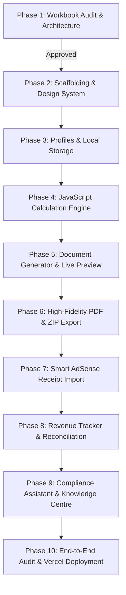

# CreatorEDF — Phase-by-Phase Implementation Roadmap & Architecture

This document outlines the systematic, phased implementation strategy for the CreatorEDF web application, adhering strictly to the non-negotiable guidelines, browser-side data privacy, and JavaScript-only architecture.

---

## 1. Technical Architecture & Stack

| Layer | Selected Technology | Rationale & Regulatory Alignment |
|---|---|---|
| **Framework** | Next.js (App Router) | High-performance, modern React architecture with static optimization and Vercel compatibility. |
| **Language** | **JavaScript Only** (`.js`, `.jsx`) | Non-negotiable requirement. No TypeScript. Clean ES6+ syntax, JSDoc annotations for type safety. |
| **Styling** | Tailwind CSS | Utility-first CSS allowing pixel-perfect replication of document margins, borders, and responsive UI. |
| **UI Components** | shadcn/ui (Radix Primitives) | Accessible, customizable, modern component library. |
| **State & Local Storage** | Browser-Side IndexedDB (`idb` / `dexie`) | 100% offline-capable, client-side persistence. Zero financial data uploaded to external servers. |
| **PDF Generation** | Vector Client-Side Engine (`@react-pdf/renderer` or `jspdf`) | Direct vector rendering of tables, borders, and text without rasterization or server reliance. |
| **Archive Bundling** | `JSZip` | In-browser bundling of EDF, Invoice, and AD Letter into a single combined compliance download. |
| **Data Ingestion** | `PapaParse` (CSV) & `pdfjs-dist` (PDF) | In-browser parsing of AdSense monthly payment receipts and transaction records. |
| **Deployment Target** | Vercel | Seamless serverless/edge static deployment. |

---

## 2. Phased Development Roadmap

### Phase 1: Research, Workbook Audit & Architectural Specification (Current Milestone)
- Deconstruct reference Excel workbook (`Creator_Export_EDF_Invoice_Utility.xlsm`).
- Map all 4 sheets, 140 inputs, formulas, hidden structures, and VBA automation.
- Audit external dependencies and missing internal rows (`$C$52:$C$55`).
- Reverse-engineer Western and Indian Number-to-Words engines.
- Conduct statutory RBI/CBIC/FEMA regulatory verification.
- Output complete architectural specifications in `docs/`.
- **Status**: Completed. Awaiting Phase 1 signoff.

### Phase 2: Project Scaffolding & Design System
- Initialize clean Next.js App Router project using JavaScript only.
- Configure Tailwind CSS, fonts (Arial, Inter), and color tokens matching document styles.
- Install and configure base shadcn/ui components (Buttons, Inputs, Cards, Dialogs, Tabs, Alerts).
- Build the responsive layout with desktop navigation and mobile drawer.
- Implement Privacy-First disclaimer banner and Local Storage status indicators.

### Phase 3: Profile & Platform Data Management (IndexedDB)
- Design and initialize client-side IndexedDB database schemas:
  - `exporterProfile` (Name, Address, PAN, GSTIN, IEC, Signatory, Mobile, Email).
  - `recipientProfiles` (Google Asia Pacific, Google LLC, Google Ireland, Meta, Patreon, custom).
  - `bankProfiles` (Bank Name, Branch Address, AD Code, Account Number, IFSC).
  - `invoices` & `receiptImports`.
- Implement Profile Management UI with pre-configured verified platform entities.
- Add "Clear My Data" and JSON backup / restore controls for data sovereignty.

### Phase 4: JavaScript Calculation Engine & Number-to-Words
- Port and unit-test all core mathematical calculations:
  - Net realisable value evaluation.
  - Foreign currency to INR conversion with bank rounding (`ROUND(Amount * Rate, 2)`).
  - Realisation deadline auto-computation (defaults to 9 months per FEMA 23(R)/2026-RB, with 12 months for INR settlements).
  - Conditional guidance engine for EDF requirement (Resident Individuals vs Non-Individuals, ₹10 Lakh threshold).
  - Conditional GST Rule 46 vs Rule 96A LUT endorsement logic (LUT active, tax paid, or unregistered).
- Implement pure JavaScript Western Number-to-Words engine (`amountToWesternWords`).
- Implement pure JavaScript Indian Number-to-Words engine (`amountToIndianWords`).
- Implement comprehensive input validator (`validateInputs`) replacing VBA `ValidateInputs()`.

### Phase 5: Document Generator & Interactive Preview Engine
- Build interactive document generation interfaces for:
  1. **EDF Form**: Full 5-section layout reproducing the 15-column grid, Section 2B table, and FEMA declaration.
  2. **Export Invoice**: Commercial tax invoice with GST LUT endorsement, SAC 998361, and Western words.
  3. **AD Code Request Letter**: Dynamic bank letterhead resolving legacy external references.
- Implement live side-by-side or tabbed document preview with real-time reactive updates.

### Phase 6: High-Fidelity PDF & ZIP Export Engine
- Implement vector PDF generation matching exact page sizes, margins ($0.25"$ and $0.7"$), and typography.
- Enable individual PDF download for EDF, Invoice, and AD Code Letter.
- Implement combined compliance packet PDF generation.
- Implement one-click combined ZIP export containing all three documents plus JSON metadata.

### Phase 7: Smart AdSense Receipt Import (PDF & CSV)
- Implement client-side PDF text extraction for Google AdSense Payment Receipts:
  - Extract Payment Date, Payment Number / Reference ID, Billing ID, and Amount.
  - Auto-populate invoice details, avoiding manual re-typing.
- Implement CSV parser for AdSense / YouTube transaction reports.

### Phase 8: AdSense Revenue Tracker & Payment Reconciliation
- Build dedicated revenue management ledger maintaining separate fields for:
  - Estimated earnings vs. Finalized earnings.
  - Deductions & invalid traffic adjustments.
  - Payment issued amount vs. Actual bank INR credit.
  - Intermediary bank charges and realized exchange rate.
- Generate monthly, quarterly, and financial year (FY April–March) summaries.
- Export revenue records to Excel (`.xlsx`), CSV, and PDF.

### Phase 9: Export Compliance Assistant & Creator Knowledge Centre
- Interactive compliance checklist for Indian creators:
  - Zero-rated export under LUT guidelines.
  - Obtaining and linking FIRC / e-FIRS from bank.
  - FEMA 9-month realization monitoring and alerts.
  - Comprehensive knowledge base explaining AD Codes, SOFTEX exemptions, and bank procedures.

### Phase 10: Verification, End-to-End Testing & Vercel Deployment
- Cross-browser validation (Chrome, Firefox, Safari, Edge, Mobile Safari).
- Verify 100% offline capability (PWA / Service Worker evaluation).
- Run full test suite for calculation engine and PDF layout fidelity.
- Deploy to Vercel and verify production build.

---

## 3. Unresolved Questions & Assumptions for Phase 1 Approval

1. **GST LUT Endorsement on Invoice (Rule 46 vs Rule 96A)**:
   - *Workbook State*: The original `Export Invoice` sheet omitted both GST details and LUT endorsements.
   - *Final Compliance Resolution*: CreatorEDF implements strict conditional logic:
     - For GST-registered creators exporting under active LUT (Form GST RFD-11): displays `"SUPPLY MEANT FOR EXPORT UNDER BOND OR LETTER OF UNDERTAKING WITHOUT PAYMENT OF INTEGRATED TAX"` along with LUT ARN.
     - For GST-registered creators paying IGST: displays `"SUPPLY MEANT FOR EXPORT ON PAYMENT OF INTEGRATED TAX"`.
     - For unregistered creators (under ₹20L/₹10L turnover): issues a clean Commercial Export Invoice with no LUT endorsement.
2. **Realisation Deadline Default (FEMA 23(R)/2026-RB)**:
   - *Workbook State*: `User Input!C38` had an arbitrarily short date (9 days after invoice).
   - *Final Compliance Resolution*: Defaults to **9 months from the invoice date** per Regulation 5(1) of FEMA 23(R)/2026-RB (as amended by Notification No. FEMA 23(R)/(1)/2026-RB), with a 12-month option for INR settlements under the Special Rupee Vostro Account (SRVA) mechanism.
3. **Conditional EDF Guidance & Single Monthly Filing (Regulation 3(2))**:
   - *Workbook State*: Assumed an EDF is universally required for every remittance and restricted to a one-recipient template.
   - *Final Compliance Resolution*: Implements conditional guidance per FEMA 23(R)/2026-RB (as amended up to Nov 2, 2026):
     - Resident individuals receive deemed submission [Reg 3(2)(a)] with no monetary cap.
     - Non-individuals receive deemed submission up to ₹10 Lakhs [Reg 3(2)(b)].
     - For services exported to one or more recipients in a month, Regulation 3(2)(c) permits submitting a single monthly EDF within 30 days from month-end. CreatorEDF supports both individual and consolidated monthly EDF options while keeping commercial tax invoices distinct per recipient.
3. **Recipient Entity Selection**:
   - *Workbook State*: Hardcoded to `Google LLC`.
   - *Proposed Resolution*: Support a pre-populated dropdown of contracting entities (Google Asia Pacific Pte Ltd, Google Ireland Ltd, Google LLC, Meta Platforms, etc.) with full custom entity override.
4. **AD Code Letter Scope**:
   - *Workbook State*: Excluded from the Excel VBA PDF export and contained broken external workbook links.
   - *Proposed Resolution*: Formally incorporate AD Code Letter into the core document suite, backing it with native Exporter & Bank Profile fields (Account Number, IFSC, Mobile, Email).

